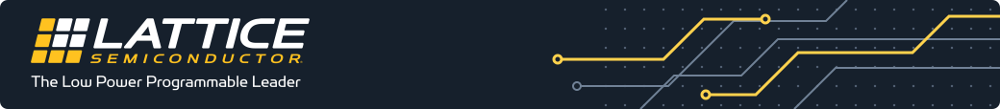
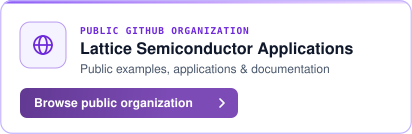
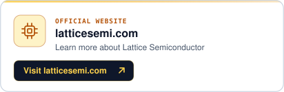

  
   
   
  <picture>
    <source media="(prefers-color-scheme: dark)" srcset="./welcome-title-dark.svg">
    <source media="(prefers-color-scheme: light)" srcset="./welcome-title-light.svg">
    
  </picture>
   
   
  
All repositories hosted here are private to Lattice employees, so there are no public projects available to browse on this page. Instead, explore our public <b>Lattice Semiconductor Applications</b> organization for open examples and documentation, or visit our official website below.

   
  

    <a href="https://github.com/Lattice-Semiconductor-Applications"><picture><source media="(prefers-color-scheme: dark)" srcset="./cards/applications-dark.svg"><source media="(prefers-color-scheme: light)" srcset="./cards/applications-light.svg"></picture></a>&nbsp;&nbsp;
    <a href="https://www.latticesemi.com/"><picture><source media="(prefers-color-scheme: dark)" srcset="./cards/website-dark.svg"><source media="(prefers-color-scheme: light)" srcset="./cards/website-light.svg"></picture></a>
  

   
  
   
   
  <a href="https://www.latticesemi.com/">Lattice Semiconductor</a>&nbsp;&nbsp;·&nbsp;&nbsp;The Low Power Programmable Leader

